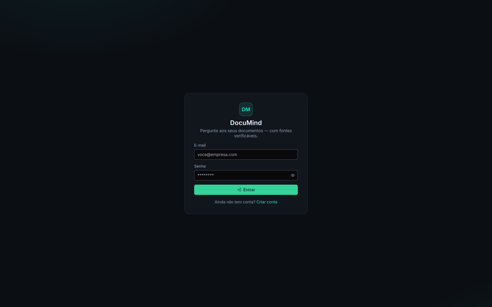
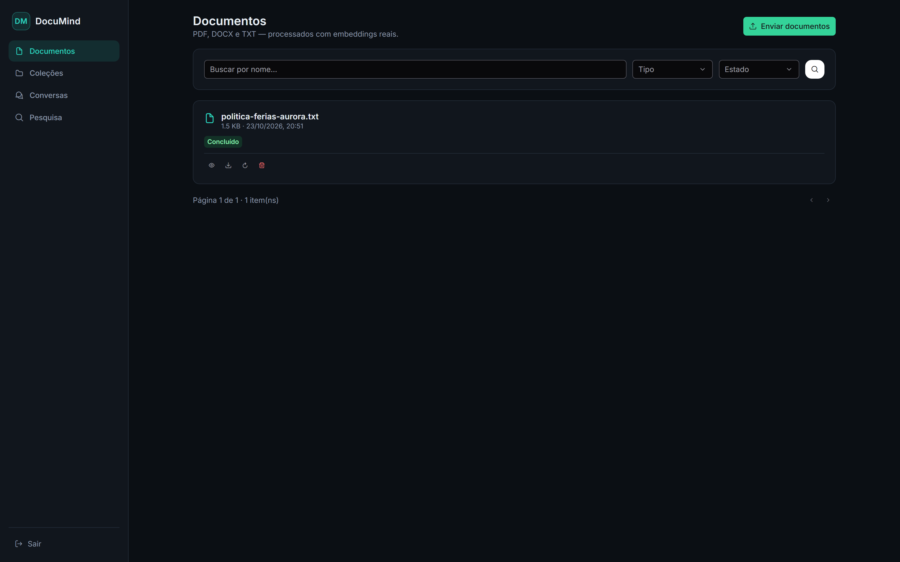
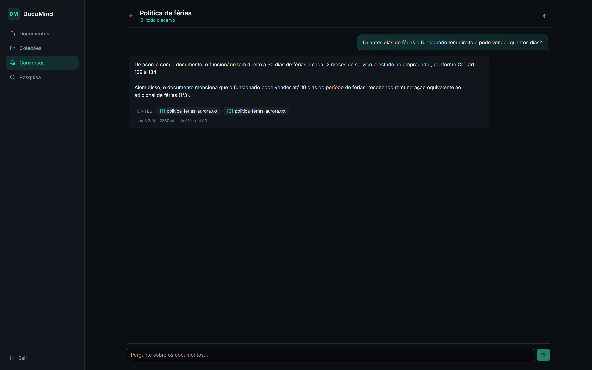
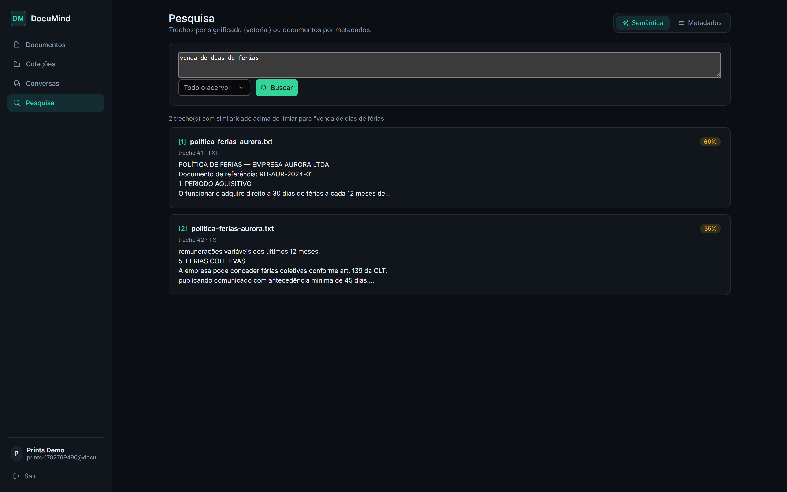

<div align="center">

# DocuMind

**Plataforma de Inteligência de Documentos com RAG — pergunte aos seus documentos e receba respostas com fontes verificáveis.**

[](https://openjdk.org/)
[](https://spring.io/projects/spring-boot)
[](https://angular.dev/)
[](https://primeng.org/)
[](https://www.postgresql.org/)
[](https://ollama.com/)
[](LICENSE)

</div>

---

> **RAG de verdade, não de fachada.** Busca vetorial real com **pgvector + índice HNSW**, embeddings
> reais do `nomic-embed-text`, **citações construídas pelo back-end** a partir dos trechos
> efetivamente recuperados — e, quando não há evidência acima do limiar de similaridade, o sistema
> responde honestamente *"não encontrei evidência nos documentos"* em vez de deixar o modelo
> inventar.

## Telas do produto

| **Login (JWT + BCrypt)** | **Documentos (ciclo de vida com polling)** |
|---|---|
|  |  |
| **Chat com citações verificáveis** | **Busca semântica (pgvector + HNSW)** |
|  |  |

**DocuMind** é uma aplicação full-stack de **RAG (Retrieval-Augmented Generation)** construída como
portfólio profissional, com:

- autenticação própria (JWT + BCrypt) e **isolamento total de dados por usuário no SQL**;
- upload de **PDF / DOCX / TXT** (até 25 MB, validação por *magic bytes*);
- **processamento assíncrono** com ciclo de vida explícito e retries;
- **chat com documentos** (individual, por coleção ou acervo completo) com respostas referenciadas;
- **busca semântica** entre trechos por similaridade de cosseno;
- política de falhas e honestidade de IA aplicada de ponta a ponta (§13);
- front-end dark premium em **Angular 22 standalone + PrimeNG**, com tokens de design em SCSS.

Tudo funciona **100% local** com Ollama — nenhum dado sai da máquina; e o cliente de IA fala o
contrato **OpenAI-compatible**, então qualquer provedor compatível (vLLM, OpenRouter, LM Studio,
Azure OpenAI, OpenAI "real") é uma troca de variável de ambiente.

---

## Índice

1. [Demonstração em 60 segundos](#1-demonstração-em-60-segundos)
2. [Visão geral do produto](#2-visão-geral-do-produto)
3. [Arquitetura](#3-arquitetura)
4. [Stack técnica](#4-stack-técnica)
5. [Funcionalidades](#5-funcionalidades)
6. [O pipeline RAG em detalhe](#6-o-pipeline-rag-em-detalhe)
7. [Modelo de dados](#7-modelo-de-dados)
8. [Pré-requisitos](#8-pré-requisitos)
9. [Instalação e execução](#9-instalação-e-execução)
10. [Variáveis de ambiente](#10-variáveis-de-ambiente)
11. [Referência da API](#11-referência-da-api)
12. [Segurança](#12-segurança)
13. [Honestidade da IA e política de falhas](#13-honestidade-da-ia-e-política-de-falhas)
14. [Exclusão, retenção e reprocessamento](#14-exclusão-retenção-e-reprocessamento)
15. [Desempenho e operação](#15-desempenho-e-operação)
16. [Testes](#16-testes)
17. [Estrutura do repositório](#17-estrutura-do-repositório)
18. [Decisões técnicas](#18-decisões-técnicas)
19. [Limitações conhecidas](#19-limitações-conhecidas)
20. [Roadmap](#20-roadmap)
21. [Solução de problemas](#21-solução-de-problemas)
22. [Licença e créditos](#22-licença-e-créditos)

---

## 1. Demonstração em 60 segundos

Depois de instalado (§9), o caminho mais curto para ver tudo funcionando:

```text
1. Abra http://localhost:4200 e crie sua conta (ou entre com um usuário de teste);
2. Upload → selecione um PDF/DOCX/TXT (ex.: uma política interna, manual, contrato);
3. Acompanhe o cartão do documento: Enviado → Aguardando → Processando → Concluído (n);
4. Crie uma Coleção "Políticas internas" e vincule o documento;
5. Conversas → Nova conversa com essa coleção → pergunte algo que EXISTE no documento:
        "Quantos dias de férias o funcionário tem direito?"
   → resposta com citações [1][2] clicáveis que abrem o documento na origem;
6. Pergunte algo que NÃO existe nos documentos:
        "Qual a política da empresa sobre financiamento imobiliário?"
   → estado SEM_EVIDENCIA: o sistema responde que não foi encontrada evidência;
   (verificação real: no documento de teste existe política de férias da empresa "Aurora",
   sem temas de financiamento)
7. Busca → modo Semântica: "venda de dias de férias" → trechos com similaridade 0.6–0.9.
```

O mesmo fluxo foi automatizado no smoke test E2E executado neste projeto (health, registro,
upload, processamento, chat com citações, busca e teste de isolamento entre usuários — 10/10 verde,
RAG respondendo `OK` com citação `[1]` fiel ao trecho original).

---

## 2. Visão geral do produto

Fluxo completo, do arquivo à resposta referenciada:

1. O usuário **envia documentos** (PDF/DOCX/TXT, até 25 MB cada), com vínculo opcional a uma coleção.
2. Assincronamente, o texto é **extraído** (PDF página a página; DOCX/TXT sem noção de página),
   **dividido em trechos** com overlap e **vira embeddings reais** via provedor OpenAI-compatible
   (por padrão Ollama local).
3. Trecho + embedding são persistidos no **PostgreSQL 18 com pgvector**, indexados por **HNSW**
   (distância de cosseno).
4. No chat, a pergunta vira embedding e a **busca vetorial** — sempre restringida por `usuario_id`,
   pelo escopo (coleção, quando houver) e pelo `modelo_embedding` configurado — recupera o top-K
   de trechos mais relevantes acima do limiar.
5. O back-end **monta o contexto numerado `[1..n]`** e envia ao modelo de chat com um prompt de
   sistema endurecido. A **citação `[n]` só existe se o trecho `[n]` estava no contexto** —
   as fontes são construídas pelo back-end, nunca pelo modelo.
6. Se a recuperação não traz nada acima do limiar, o fluxo nem chama o modelo: responde
   **`SEM_EVIDENCIA`** com texto honesto, persistido no histórico.
7. Na UI, cada citação é clicável e leva ao documento + trecho/página de origem.

**Sem IA configurada, o sistema é honesto:** sobe normalmente, mas os endpoints de RAG respondem
`503 IA_NAO_CONFIGURADA` e o `/api/health` mostra `ia.configurado=false`. Nunca há respostas
simuladas, dados de exemplo "enganadores" nem fontes inventadas.

---

## 3. Arquitetura

```
┌──────────────────────────────┐        HTTPS / JSON         ┌─────────────────────────────┐
│  Front-end (Angular 22)      │ ──────────────────────────► │  Back-end (Spring Boot 3.5) │
│  Angular standalone +        │ ◄────────────────────────── │  Java 21 (virtual threads)  │
│  PrimeNG + SCSS dark         │        JWT Bearer           │                             │
└──────────────────────────────┘                             │  Controllers (sem regras)   │
                                                             │   ├─ Services (regras)      │
                                                             │   ├─ Services de IA (RAG)   │
                                                             │   ├─ Repositórios           │
                                                             │   │   (JPA + SQL nativo     │
                                                             │   │    para vetores)        │
                                                             │   └─ Flyway (schema)        │
                                                             └───────┬──────────────┬──────┘
                                                                     │              │
                                                        ┌────────────▼─────┐  ┌─────▼──────────────┐
                                                        │  PostgreSQL 18   │  │  Ollama (local)    │
                                                        │  + pgvector 0.8  │  │  contrato OpenAI   │
                                                        │  HNSW cosine     │  │  chat + embeddings │
                                                        └──────────────────┘  └────────────────────┘
```

### Camadas do back-end (`com.documind`)

| Pacote | Responsabilidade |
|---|---|
| `config` | Propriedades tipadas (`AppProperties`, `AiProperties`), Security/CORS, Async, Agendamento, OpenAPI |
| `common` | Hierarquia de exceções + `ApiError` consistente + `GlobalExceptionHandler` + `PageResponse` |
| `security` | `JwtService`, filtros de autenticação e de rate limit, `AuthFacade` (identidade na thread) |
| `usuario` | Registro / login / `me` (BCrypt, e-mail único) |
| `documento` | Upload/validação/armazenamento, extração de texto (PDFBox/POI/TXT), chunking, listagem/detalhe/download/reprocess/exclusão |
| `processamento` | Fila assíncrona em banco (tarefa + estados), pipeline extração→chunks→embeddings, cancelamento cooperativo, reenfileiramento de órfãos |
| `rag` | `VectorSearchRepository` (SQL nativo pgvector), cliente OpenAI-compatible (embeddings/chat com retry), `RagService` (recuperação + geração), prompts endurecidos |
| `colecao` | CRUD de coleções e vínculos com documentos (escopo de pesquisa do RAG) |
| `conversa` | Conversas, mensagens, citações com snapshot, orquestração pergunta → RAG → resposta + citações |
| `busca` | `GET /api/search` (metadados) e `POST /api/search/semantic` (vetorial) |
| `health` | `GET /api/health` com estado real do banco e da configuração de IA |

Princípios estruturais aplicados de forma consistente:

- **Controllers não contêm regra de negócio** — apenas HTTP, validação de entrada e delegação.
- **DTOs apenas na superfície HTTP** — entidades JPA nunca são serializadas.
- **Regras nos serviços** — estados transicionais, permissões, limiares e orquestração vivem em
  classes de domínio testáveis.
- **Identidade sempre do contexto de segurança** — nenhuma rota aceita `usuarioId` do cliente.

### Front-end (Angular 22 standalone)

- Páginas: Login · Registro · Layout com navegação · Documentos (upload, filtros, polling,
  detalhe, download, reprocess, exclusão) · Coleções · Conversas · Chat (conversa detalhada com
  citações clicáveis → rota `/documentos?doc=<id>` que abre o painel de origem) · Busca
  (metadados + semântica).
- Comunicação central em `core/documind-api.service.ts`; **interceptor funcional** injeta o JWT e
  normaliza erros da API (`extrairApiError`).
- Guards de rota por autenticação; polling de estados transitórios apenas quando há documento
  em andamento (economia de requests).
- Tema dark com tokens de design definidos uma única vez (`styles.scss`): fundo `#0B0F14`,
  superfícies `#11161D` / `#1A212B`, borda `#232C38`, texto `#E6EDF3`/`#8B98A9`, acento teal
  `#2DD4BF`, perigo `#F87171`, aviso `#FBBF24`, sucesso `#34D399`; tipografia Inter.

---

## 4. Stack técnica

| Camada | Tecnologia | Versão |
|---|---|---|
| Back-end | Java + Spring Boot (virtual threads habilitados) | 21 / 3.5.16 |
| Build | Maven (wrapper incluído) | 3.9.11 |
| Segurança | Spring Security + JJWT (HMAC-SHA2, ≥ HS256) | 6.5 / 0.13.0 |
| Banco | PostgreSQL + pgvector | 18 / 0.8.7 |
| Migrações | Flyway (`V1__documind_schema.sql`) | — |
| Busca vetorial | pgvector HNSW (`vector_cosine_ops`) | — |
| Extração PDF | Apache PDFBox | 3.0.8 |
| Extração DOCX | Apache POI | 5.4.1 |
| API docs | springdoc-openapi (Swagger UI) | 2.8.17 |
| Testes back | JUnit 5 + AssertJ | — |
| Front-end | Angular (standalone, sem NgModules) | 22.2.0 |
| UI Kit | PrimeNG + PrimeIcons | 22.1.4 / 8.0.2 |
| Tipografia | Inter (`@fontsource/inter`) | 5.3.0 |
| IA (padrão) | Ollama local | `llama3.2:3b` + `nomic-embed-text` (768 dims) |

O cliente de IA usa o contrato **OpenAI-compatible** (`/v1/embeddings`, `/v1/chat/completions`), então
funciona com **Ollama, vLLM, OpenRouter, LM Studio, Azure OpenAI etc.** — **nenhum modelo fica fixado
no código**: tudo vem de variáveis de ambiente (§10).

---

## 5. Funcionalidades

### Conta
- Registro com e-mail único e senha com mínimos de segurança (BCrypt).
- Login com emissão de JWT (HMAC-SHA2, expiração configurável) + tipo Bearer + prazo.
- `GET /api/auth/me` para identidade do usuário autenticado (fonte de verdade do perfil na UI).

### Documentos
- Upload **múltiplo** (mesma tela) com vínculo opcional a uma coleção existente.
- Validação por **assinatura binária (magic bytes)** — o `content-type` alegado pelo cliente não é
  confiável; o MIME real é reconstruído no servidor; nomes de arquivo sanitizados.
- Ciclo de vida explícito: `ENVIADO → AGUARDANDO_PROCESSAMENTO → PROCESSANDO → CONCLUIDO`
  (ou `FALHOU` com mensagem legível para o usuário). Consulta de status por documento
  (`GET /{id}/status`) com **polling** controlado pela UI.
- Listagem com filtros combinados (nome, tipo, estado, coleção, data), paginação estável.
- Detalhe com metadados completos (quantidade de trechos, modelo de embedding usado, tarefa de
  processamento, tentativas e último erro).
- Download do original (stream autenticado, dono validado antes de abrir o arquivo).
- Reprocessamento (nova tarefa em fila) e exclusão consistente (§14).

### Coleções (escopo de RAG)
- CRUD + vínculo/desvínculo de documentos.
- Definição de produto, documentada: **excluir a coleção NÃO exclui os documentos** — só o
  container some; conversas com esse escopo passam a buscar no acervo completo (FK `SET NULL`).

### Conversas (chat com os documentos)
- Histórico persistido (usuário + assistente), renomear, escopo opcional por coleção.
- **Resposta com citações `[1..n]`**: cada citação referencia documento, trecho, página e o
  **conteúdo do trecho na época** (snapshot).
- Mensagens de assistente carregam estado honesto: `OK`, `SEM_EVIDENCIA` ou `ERRO` — a UI exibe
  cada estado sem "adivinhar".

### Pesquisa
- `GET /api/search`: pesquisa por metadados (mesma engine de filtros da listagem de documentos).
- `POST /api/search/semantic`: pesquisa semântica de trechos por similaridade, exigindo apenas
  embeddings configurados (chat não é necessário), com isolamento por usuário e escopo.

### Operação
- `GET /api/health`: público, diagnóstico real de banco (`UP/DOWN`) e IA (base URL, modelos,
  dimensões, flags de configuração).
- Swagger UI em `/swagger-ui.html` para exploração interativa da API.

---

## 6. O pipeline RAG em detalhe

```
UPLOAD
  ──► extração de texto  (PDF: página a página; DOCX/TXT: contínuo, sem páginas)
  ──► chunking           (1200 chars por trecho, overlap 200, corte respeitando frases/linhas)
  ──► embeddings         (lotes de 16; nomic-embed-text → 768 dimensões)
  ──► persistência       (pgvector; metadados: página(s), índice, modelo_embedding; índice HNSW)

PERGUNTA
  ──► embedding da pergunta (mesmo modelo configurado)
  ──► busca cosseno HNSW com predicados do SQL:
        usuario_id = X  ·  (colecao_id IN escopo opcional)  ·  modelo_embedding = modelo atual
  ──► filtro de limiar   (similaridade >= 0.35 default) e top-K (6 trechos default)
  ──► contexto numerado [1..n]   (a numeração é atribuída PELO BACKEND)
  ──► prompt de sistema endurecido (ver abaixo) + histórico da conversa
  ──► resposta do modelo com referências [n]
  ──► persistência: mensagem + citações com SNAPSHOT do trecho (conteúdo + página + índice)

SEM EVIDÊNCIA
  ──► recuperação vazia/abaixo do limiar ⇒ NÃO chama o modelo de chat
      ⇒ resposta fixa honesta, mensagem persistida com estado SEM_EVIDENCIA
```

Engenharia que sustenta a corretude do RAG:

- **Isolamento no SQL, não no prompt.** Todo predicado de segurança (`usuario_id`, escopo de
  coleção) é cláusula de WHERE na query vetorial — o modelo não pode "ver" dados de outros
  usuários nem "esquecer" o escopo.
- **Espaço de embeddings por modelo.** A busca filtra sempre pelo `modelo_embedding` configurado:
  vetores de modelos diferentes nunca são comparados entre si.
- **Numeração e citação nascem no backend.** O modelo só referencia `[n]` presente no contexto;
  as fontes devolvidas pela API derivam daqueles trechos concretos (documento, página, índice).
- **Prompt injection é tratado como dado.** Texto recuperado entra no prompt como material citável,
  não como instrução; o modelo é instruído a ignorar comandos contidos em documentos.
- **Resposta fixa de `SEM_EVIDENCIA` é decisão do backend**, determinística e testável.
- **Dimensão travada no schema** (`embedding vector(768)`): pgvector exige typmod para criar o
  índice HNSW; o cliente valida a dimensão de cada lote recebido e um novo modelo de embeddings
  passa por migração explícita (§18, decisão 2).

---

## 7. Modelo de dados

Schema gerido **exclusivamente** por migrações Flyway (`V1__documind_schema.sql`). Resumo:

| Tabela | Papel | Notas de integridade |
|---|---|---|
| `usuario` | conta | e-mail único; senha hash BCrypt |
| `documento` | arquivo do usuário | nome original/armazenado, MIME real, tamanho, `estado`, mensagem de erro, modelo de embedding, contadores reais |
| `trecho_documento` | chunk + vetor | `embedding vector(768)`, `modelo_embedding`, índice do trecho, página(s); FK `ON DELETE CASCADE` → documento; índice **HNSW cosine** |
| `tarefa_processamento` | fila + retries | estados da tarefa, tentativas, último erro; reenfileiramento de órfãos no boot |
| `colecao` | escopo | nome único por usuário |
| `documento_colecao` | vínculo N:N | FK dupla `ON DELETE CASCADE` |
| `conversa` | chat | FK coleção **SET NULL** (perde o escopo, preserva o histórico) |
| `mensagem` | USUARIO / ASSISTENTE | `estado` (`OK` / `SEM_EVIDENCIA` / `ERRO`); `metadados` JSON (modelo, tokens, latência, trechos no contexto) |
| `citacao` | fonte da resposta | FK documento `CASCADE`; FK trecho **SET NULL** + snapshot de conteúdo/página preservado na própria linha |

> A dimensão 768 acompanha o modelo padrão `nomic-embed-text`; trocar de modelo de embeddings é
> decisão deliberada, acompanhada de migração (§6, §18).

Relações relevantes para operação e auditoria:

```
usuario 1─N documento 1─N trecho_documento
                    │            ▲
                    └─N─documento_colecao─N─┐ (colecao)
conversa N─1 (colecao, SET NULL)
conversa 1─N mensagem 1─N citacao N─1 documento (CASCADE) / N─1 trecho_documento (SET NULL)
documento 1─N tarefa_processamento
```

---

## 8. Pré-requisitos

1. **PostgreSQL 18 + pgvector 0.8.7**
   - No Windows, `scripts/install-pgvector.ps1` (como administrador) instala a extensão na
     instalação existente do PostgreSQL.
   - O script `scripts/setup-database.ps1` (§9) cria o role/database e habilita `CREATE EXTENSION vector`.

2. **Ollama + modelos** (provedor de IA padrão, executado localmente):

   ```powershell
   winget install Ollama.Ollama
   ollama pull llama3.2:3b        # modelo de chat (melhor equilíbrio qualidade/latência local)
   ollama pull nomic-embed-text   # modelo de embeddings (768 dims)
   ```

   > **Escolha do modelo de chat pelo hardware** (medido em máquina com GPU modesta, split
   > CPU/GPU): o `llama3.1:8b` gerava ~2,4 tokens/s com latência de minutos por resposta RAG;
   > o `llama3.2:3b` reduziu a mesma resposta para ~45 s com qualidade igual para o caso de uso
   > (respostas extrativas com citações). Verificar o posicionamento com `ollama ps`: modelos que
   > ficam 100% na VRAM são os únicos candidatos a 8B+. O modelo é configurável por ambiente —
   > nunca fixo no código.

3. **JDK 21+** (o build compila com `--release 21`; qualquer JDK ≥ 21 serve) e **Node.js 20+**.

4. Opcional: qualquer provedor **OpenAI-compatible** (OpenAI, vLLM, OpenRouter, LM Studio...)
   pode substituir o Ollama — basta apontar `DOCUMIND_AI_BASE_URL` e definir os modelos desejados.

---

## 9. Instalação e execução

### 9.1 Banco + `.env` local (Windows)

```powershell
# Na raiz do projeto:
powershell -ExecutionPolicy Bypass -File scripts/setup-database.ps1
```

O script interativo:

1. pede a senha do superusuário `postgres` e a senha desejada para o novo usuário da aplicação;
2. cria (ou atualiza) o role `documind` e o database `documind` com o usuário como owner;
3. habilita a extensão pgvector e garante permissões no schema;
4. gera `backend/.env` local (**nunca versionado**) com as credenciais e um **segredo JWT
   aleatório** de 48 bytes (base64);
5. valida ao final conectando com o usuário da aplicação (`CONEXAO_APP_OK`).

### 9.2 Backend

```powershell
.\run-backend.ps1            # carrega backend/.env, aplica migrations e sobe em :8080
```

- Swagger: <http://localhost:8080/swagger-ui.html>
- Health: <http://localhost:8080/api/health>
- Guia sem script: `cd backend` e usar `mvnw.cmd spring-boot:run` com as variáveis do §10 exportadas.

### 9.3 Front-end

```powershell
cd frontend
npm install
npm start                    # http://localhost:4200
```

> **Porta 4200 ocupada?** (ex.: outro projeto Angular rodando) suba o DocuMind em outra porta:
>
> ```powershell
> npx ng serve --port 4201
> ```
>
> e autorize a nova origem no backend: `DOCUMIND_CORS_ORIGINS=http://localhost:4200,http://localhost:4201`
> (o `.env` já aceita lista separada por vírgula).

> **Licença PrimeUI (PrimeNG 22).** O PrimeNG v22 usa o modelo de licença Community/Commercial e
> exibe um aviso local (`Invalid PrimeUI License`) quando não há chave configurada — **sem bloquear
> nenhuma funcionalidade**. Para devs individuais a chave Community é gratuita: solicite em
> <https://primeui.dev> e cole-a em `frontend/src/app/core/primeui-license.ts`; a validação é
> 100% local. Sem a chave, o app funciona normalmente e apenas o aviso permanece.

### 9.4 Testes rápidos pós-instalação

```bash
curl http://localhost:8080/api/health          # {"banco":{"estado":"UP"}, "ia":{"configurado":true,...}}
```

Testes unitários do backend: `cd backend; .\mvnw.cmd test`.
Testes de integração (banco real, gated): `$env:DOCUMIND_IT="true"; .\mvnw.cmd test`.
Testes do front-end: `cd frontend; npx ng test`.

---

## 10. Variáveis de ambiente

Todas têm default funcional exceto `DOCUMIND_JWT_SECRET` **(obrigatória)** e as de credencial do
banco, definidas pelo setup. Referência completa em `.env.example`. Nenhum segredo é commitado —
`.gitignore` cobre `.env`, `*.env` e `backend/storage/`.

### Banco e servidor

| Variável | Descrição | Default |
|---|---|---|
| `DOCUMIND_DB_URL` | JDBC do PostgreSQL | `jdbc:postgresql://localhost:5432/documind` |
| `DOCUMIND_DB_USERNAME` | usuário do banco | `documind` |
| `DOCUMIND_DB_PASSWORD` | senha do banco (definida no setup) | `documind` |
| `DOCUMIND_JWT_SECRET` | segredo HMAC **(obrigatória, ≥ 32 chars)**; ausente/curta → aborta o startup com erro claro | — |
| `DOCUMIND_JWT_EXP_MINUTES` | validade do token de acesso (min) | `120` |
| `DOCUMIND_CORS_ORIGINS` | origens permitidas (separadas por vírgula) | `http://localhost:4200` |
| `SERVER_PORT` / `server.port` | porta HTTP do backend | `8080` |

> Compatibilidade: o `.env` também funciona com `SPRING_DATASOURCE_URL/USERNAME/PASSWORD` — as
> variáveis `SPRING_*` do Spring têm precedência maior que o YAML, e as `DOCUMIND_DB_*` são
> resolvidas dentro do YAML. Escolha um padrão e mantenha-o.

### Documentos e limites

| Variável | Descrição | Default |
|---|---|---|
| `DOCUMIND_DOCUMENT_MAX_SIZE_MB` | tamanho máximo por arquivo (também limita multipart) | `25` |
| `DOCUMIND_DOCUMENT_UPLOADS_PER_HOUR` | limite de uploads por usuário/hora (excede → `429`) | `30` |
| `DOCUMIND_DOCUMENT_STORAGE_PATH` | pasta de armazenamento dos originais | `./storage` |
| `DOCUMIND_RATE_LIMIT_PER_MINUTE` | requisições por minuto por IP (rotas de IA: por usuário) | `60` |

### Pipeline RAG (chunking)

| Variável | Descrição | Default |
|---|---|---|
| `DOCUMIND_RAG_CHUNK_SIZE_CHARS` | tamanho alvo de cada trecho (chars) | `1200` |
| `DOCUMIND_RAG_CHUNK_OVERLAP_CHARS` | sobreposição entre trechos consecutivos | `200` |

### Integração de IA (OpenAI-compatible)

| Variável | Descrição | Default |
|---|---|---|
| `DOCUMIND_AI_BASE_URL` | base do provedor (ex.: `http://localhost:11434/v1`); vazia ⇒ IA desativada (`503` claro) | vazio |
| `DOCUMIND_AI_API_KEY` | Bearer quando o provedor exige (Ollama local: vazio) | vazio |
| `DOCUMIND_AI_CHAT_MODEL` | modelo de chat (ex.: `llama3.2:3b`) | vazio |
| `DOCUMIND_AI_EMBEDDING_MODEL` | modelo de embeddings (ex.: `nomic-embed-text`) | vazio |
| `DOCUMIND_AI_EMBEDDING_DIMENSIONS` | dimensão esperada; validada em cada lote recebido | `768` |
| `DOCUMIND_AI_MAX_CONTEXT_CHUNKS` | K trechos que entram no contexto | `6` |
| `DOCUMIND_AI_MIN_RELEVANCE_THRESHOLD` | similaridade mínima de cosseno para aceitar trecho (0..1) | `0.35` |
| `DOCUMIND_AI_REQUEST_TIMEOUT_SECONDS` | timeout por chamada ao provedor | `120` |
| `DOCUMIND_AI_MAX_RETRIES` | tentativas extras em falha temporária (timeout, 5xx) | `2` |
| `DOCUMIND_AI_EMBEDDING_BATCH_SIZE` | trechos por chamada de embeddings | `16` |
| `DOCUMIND_AI_MAX_OUTPUT_TOKENS` | teto de tokens de saída do chat | `1024` |

**Dica de hardware:** se o chat estourar o timeout (ver §21), aumente
`DOCUMIND_AI_REQUEST_TIMEOUT_SECONDS` (local: `300`) ou migre o chat para um modelo menor — a
config é pontual e isolada.

---

## 11. Referência da API

Autenticação por `Authorization: Bearer <JWT>` em todas as rotas, exceto
`/api/auth/register`, `/api/auth/login`, `/api/health` e Swagger.
Formato de erro padrão em toda a API:

```json
{ "status": 403, "code": "ACESSO_NEGADO", "message": "Você não tem acesso a este documento.", "violations": [] }
```

### 11.1 Autenticação — `/api/auth`

| Método | Caminho | Corpo | Respostas |
|---|---|---|---|
| `POST` | `/register` | `{ "nome", "email", "senha" }` | `201` `TokenResponse`; `409 CONFLITO` se e-mail existir; `400 VALIDACAO` |
| `POST` | `/login` | `{ "email", "senha" }` | `200` `TokenResponse`; `401 NAO_AUTORIZADO` para credenciais inválidas |
| `GET` | `/me` | — (Bearer) | `200` usuário atual |

`TokenResponse`:

```json
{
  "token": "eyJhbGciOi...",
  "tipo": "Bearer",
  "expiraEm": "2026-10-22T21:48:34Z",
  "usuario": { "id": 1, "nome": "Maria Silva", "email": "maria@empresa.com", "dataCriacao": "..." }
}
```

### 11.2 Documentos — `/api/documents`

| Método | Caminho | Descrição | Respostas |
|---|---|---|---|
| `POST` | `/` | multipart com campo `arquivos` (repetível) + `colecaoId` opcional | `201` lista de `DocumentoResponse` |
| `GET` | `/` | filtros `nome`, `tipo`, `estado`, `colecaoId`, `data` + `page`/`size` | `200` `PageResponse<DocumentoResponse>` |
| `GET` | `/{id}` | detalhe completo (trechos, tarefa, tentativas) | `200` / `404` |
| `GET` | `/{id}/status` | polling do processamento: `estado`, `quantTrechos`, `mensagemErro` | `200` |
| `GET` | `/{id}/download` | stream do arquivo original (dono validado antes de abrir) | `200` binário |
| `POST` | `/{id}/reprocess` | reenfileira o processamento | `202` |
| `DELETE` | `/{id}` | exclusão consistente (§14) | `204` |

Exemplo — enviar um documento e acompanhar:

```bash
curl -X POST http://localhost:8080/api/documents \
  -H "Authorization: Bearer $TOKEN" \
  -F "arquivos=@politica-ferias.pdf"

# → [ { "id": 7, "nomeOriginal": "politica-ferias.pdf", "estado": "AGUARDANDO_PROCESSAMENTO", ... } ]

curl http://localhost:8080/api/documents/7/status -H "Authorization: Bearer $TOKEN"
# → { "estado": "CONCLUIDO", "quantTrechos": 12, "mensagemErro": null }
```

### 11.3 Coleções — `/api/collections`

| Método | Caminho | Descrição |
|---|---|---|
| `POST` | `/` | cria coleção `{ "nome", "descricao?" }` (nome único por usuário; `409` em duplicidade) |
| `GET` | `/` | lista as coleções do usuário |
| `GET` | `/{id}` | detalhe + documentos vinculados |
| `PUT` | `/{id}` | renomear/descrição |
| `POST` | `/{id}/documents` | vincula `{ "documentoId": n }` |
| `DELETE` | `/{id}/documents/{documentoId}` | desvincula (documento permanece) |
| `DELETE` | `/{id}` | exclui o container — **documentos preservados** (§14) |

### 11.4 Conversas — `/api/conversations`

| Método | Caminho | Descrição |
|---|---|---|
| `POST` | `/` | cria conversa `{ "titulo", "colecaoId?" }` (escopo opcional) |
| `GET` | `/` | lista conversas do usuário |
| `GET` | `/{id}` | resumo da conversa |
| `PATCH` | `/{id}` | renomear `{ "titulo" }` |
| `GET` | `/{id}/messages` | histórico (usuário + assistente + estado + citações) |
| `POST` | `/{id}/messages` | **pergunta RAG** `{ "conteudo": "..." }` → resposta com citações |
| `DELETE` | `/{id}` | exclui conversa + mensagens (em cascata) |

Exemplo — a pergunta que define o produto:

```bash
curl -X POST http://localhost:8080/api/conversations/3/messages \
  -H "Authorization: Bearer $TOKEN" -H "Content-Type: application/json" \
  -d '{ "conteudo": "Quantos dias de férias o funcionário tem direito e pode vender quantos?" }'
```

```json
{
  "estado": "OK",
  "conteudo": "O funcionário tem direito a 30 dias de férias a cada 12 meses [1] e pode vender até 10 dias [2].",
  "citacoes": [
    {
      "referencia": 1,
      "documentoNome": "politica-ferias.pdf",
      "paginaInicio": 1,
      "indiceTrecho": 0,
      "conteudoTrecho": "1. Período aquisitivo — O funcionário tem direito a 30 dias ..."
    }
  ],
  "metadados": { "modelo": "llama3.2:3b", "trechosContexto": 12, "tokensEntrada": 554, "tokensSaida": 104 }
}
```

### 11.5 Pesquisa — `/api/search` e `/api/health`

| Método | Caminho | Descrição |
|---|---|---|
| `GET` | `/api/search` | pesquisa por **metadados**: `nome`, `tipo`, `estado`, `colecaoId`, `data`, `page`, `size` |
| `POST` | `/api/search/semantic` | pesquisa **semântica**: `{ "pergunta", "colecaoId?" }` → trechos com `similaridade` (só exige embeddings) |
| `GET` | `/api/health` | público; `banco.estado` (`UP`/`DOWN`) + `ia` (configurado? embeddings? base? modelos? dimensões) |

```bash
curl -X POST http://localhost:8080/api/search/semantic \
  -H "Authorization: Bearer $TOKEN" -H "Content-Type: application/json" \
  -d '{ "pergunta": "venda de dias de férias", "colecaoId": 2 }'
# → { "resultados": [ { "referencia": 1, "similaridade": 0.674, "documentoNome": "politica-ferias.pdf", "paginaInicio": 1, ... } ] }
```

### 11.6 Códigos de erro padronizados

| HTTP | `code` | Quando |
|---|---|---|
| `400` | `VALIDACAO` | corpo/parâmetros inválidos (com `violations[]` por campo) |
| `400` | `REQUISICAO_INVALIDA` | requisição malformada (ex.: nenhum arquivo no multipart) |
| `400` | `ARQUIVO_INVALIDO` | conteúdo não corresponde ao tipo declarado / extensão não permitida |
| `400` | `ARQUIVO_GRANDE` | acima do tamanho máximo |
| `401` | `NAO_AUTORIZADO` | ausência/invalidade de credenciais |
| `403` | `ACESSO_NEGADO` | recurso de outro usuário |
| `404` | `NAO_ENCONTRADO` | recurso inexistente para o usuário |
| `409` | `CONFLITO` | e-mail duplicado; nome de coleção duplicado |
| `429` | `LIMITE_EXCEDIDO` | rate limit (por IP ou usuário) |
| `502` | `PROVEDOR_IA_INDISPONIVEL` | provedor de IA falhou após retries |
| `503` | `IA_NAO_CONFIGURADA` | pipeline de IA sem `DOCUMIND_AI_*` |
| `500` | `ERRO_INTERNO` | inesperado — registrado com stack no log, **nunca** exposto |

---

## 12. Segurança

- **JWT (HMAC-SHA2).** Segredo **obrigatório ≥ 32 caracteres** — ausente/fraco **aborta o boot**
  (fail-fast; nada de segredo default forjador de tokens). Com segredo de 48 bytes o JJWT emite
  HS512; o piso contratual do projeto é HS256. Claims: `sub` (id do usuário), `email`, `iat`, `exp`.
- **Credenciais.** BCrypt; e-mail único com índice no banco; senha com mínimos de política.
- **Autorização em cada consulta.** A identidade vem do contexto de segurança (`AuthFacade`) —
  rota nenhuma aceita `usuarioId` do cliente; Specifications JPA e SQL nativo filtram por ela.
  Detalhe de documento/outro usuário → `403 ACESSO_NEGADO` (comprovado em E2E: usuário intruso
  lista 0 documentos e recebe 403 ao acessar detalhes).
- **Rate limiting.** Janela fixa em memória por IP nas rotas de auth e por usuário nas rotas de
  IA; excede → `429 LIMITE_EXCEDIDO`.
- **Upload seguro.** Extensão em whitelist (`pdf/docx/txt`), verificação de *magic bytes* por tipo
  (PNG/JPEG/PE executável mascarado como `.txt` é rejeitado), tamanho checado antes do processamento,
  nomes sanitizados; armazenamento com nome UUID dentro do path configurado.
- **CORS e headers.** Origens por lista explícita (`DOCUMIND_CORS_ORIGINS`); Spring Security com
  headers de segurança; erros sem stack/include-message (`server.error.include-*: never`).
- **SQL de vetores parametrizado.** `CAST(? AS vector)` e `?::vector` com `JdbcTemplate` —
  sem concatenação de string em ponto nenhum da busca vetorial.

---

## 13. Honestidade da IA e política de falhas

| Situação | Comportamento do sistema |
|---|---|
| IA não configurada (`DOCUMIND_AI_*` vazios) | o app **sobe**; endpoints de IA → `503 IA_NAO_CONFIGURADA`; `/api/health` mostra `ia.configurado=false` |
| Provedor fora / timeout / 5xx | retry configurável; persistindo a falha → `502 PROVEDOR_IA_INDISPONIVEL` com texto genérico (detalhes só no log do servidor) |
| Recuperação vazia ou abaixo do limiar | **não chama o modelo**; resposta fixa honesta persistida com estado `SEM_EVIDENCIA` |
| Embeddings fora da dimensão esperada | lote abortado; tarefa/documento `FALHOU` com mensagem legível |
| Qualquer pergunta do usuário | **sempre persistida** — o histórico é fiel mesmo em falha (estado `ERRO`) |

Nada de respostas "concluídas" falsas: a mensagem de assistente traz sempre um estado explícito e
a UI o exibe. Fontes inexistentes não existem — citação sem trecho recuperado é impossível por
construção (§6).

---

## 14. Exclusão, retenção e reprocessamento

- **Excluir documento:** cancelamento cooperativo do processamento (flag checada por lote) →
  `DELETE` com **FK CASCADE** (trechos + embeddings + tarefas + citações) → remoção do arquivo no
  disco. **Não sobra trecho recuperável pelo RAG** — a cascata é atômica no banco e o arquivo é
  removido. Medida defensiva adicional: o worker verifica a existência do documento antes de cada
  lote (`Processamento abortado: documento X removido`).
- **Excluir coleção:** remove apenas o container; documentos permanecem; conversas com esse escopo
  perdem a coleção via `SET NULL` (histórico intacto).
- **Excluir conversa:** mensagens + citações removidas em cascata.
- **Reprocessar:** enfileira nova tarefa; citações antigas preservam o **snapshot** (FK de trecho
  é `SET NULL` de propósito), então referências antigas continuam legíveis mesmo com os trechos
  reindexados.

---

## 15. Desempenho e operação

- **Virtual threads** (`spring.threads.virtual.enabled=true`): I/O-bound do pipeline e das chamadas
  de IA escala bem com threads baratas.
- **Índice HNSW** (`vector_cosine_ops`): busca vetorial sublinear; pool Hikari 10/2.
- **Embeddings em lotes** (`DOCUMIND_AI_EMBEDDING_BATCH_SIZE`) com timeout próprio; o processamento
  é serial por documento com agendamento de reenfileiramento (tarefa órfã de boot volta à fila).
- **Polling amigável**: a UI polla `status` apenas quando há documento em estado transitório
  (`2,5 s`), desligando o loop com o acervo estável.
- **Medição real (máquina de referência, GPU modesta com split CPU/GPU):**
  processamento de TXT de ~700 bytes → 1 trecho indexado em ~5 s; resposta RAG completa
  (`llama3.2:3b`) em ~45 s (554 tokens de entrada, 104 de saída). Em máquina com VRAM para 8B+,
  a mesma rota tende a < 10 s com `llama3.1:8b`.

---

## 16. Testes

### Backend (`cd backend`)

| Suíte | Escopo | Como rodar |
|---|---|---|
| `ChunkingServiceTest` | limites, overlap, páginas, normalização | `.\mvnw.cmd test` |
| `DocumentoUploadValidatorTest` | magic bytes, extensão, sanitização de nome | `.\mvnw.cmd test` |
| `PromptTemplatesTest` | regras anti-injeção, numeração backend, escopo | `.\mvnw.cmd test` |
| `JwtServiceTest` | fail-fast de segredo, roundtrip, expiração | `.\mvnw.cmd test` |
| `DocumindIt` | banco real: extensão vector, 9 tabelas, dimensão 768 | `$env:DOCUMIND_IT="true"; .\mvnw.cmd test` |

O conjunto de integração é **gated** por `DOCUMIND_IT` para não exigir infraestrutura em toda
execução local/CI.

### Front-end (`cd frontend`)

```powershell
npx ng build              # bundle de produção limpo (orçamentos de bundle aplicados)
npx ng test               # testes unitários (vitest) — ex.: shell do app
```

### Smoke test E2E (manual, cenários de §1)

```powershell
powershell -ExecutionPolicy Bypass -File scripts/smoke-test.ps1
```

O script `scripts/smoke-test.ps1` automatiza o fluxo completo: health → registro (2 usuários) →
upload TXT → polling até `CONCLUIDO` → detalhe → coleção + vínculo → pergunta RAG (espera `OK` +
citações) → pergunta sem evidência → busca semântica → teste de isolamento entre usuários.
Reportado laranja/verde passo a passo no console; critérios: estado `CONCLUIDO` com trechos ≥ 1,
`modeloEmbedding` correto, citações presentes, `403/404` no acesso alheio.

---

## 17. Estrutura do repositório

```
documind/
├── backend/
│   ├── mvnw / mvnw.cmd          # Maven wrapper (o projeto não exige Maven instalado)
│   ├── pom.xml
│   ├── .env                     # gerado pelo setup — NUNCA versionado
│   └── src/
│       ├── main/java/com/documind/     # pacotes por domínio (§3)
│       ├── main/resources/
│       │   ├── application.yml         # defaults; tudo sobrescrito por DOCUMIND_*
│       │   └── db/migration/V1__documind_schema.sql
│       └── test/java/                  # unitários + DocumindIt (gated)
├── frontend/                    # Angular 22 standalone + PrimeNG (gerado por ng new)
│   └── src/app/
│       ├── core/                # modelos, auth service, interceptor, guards, API client
│       ├── layout/              # shell com navegação
│       └── pages/               # login, register, documentos, colecoes, conversas, busca
├── scripts/
│   ├── install-pgvector.ps1     # pgvector 0.8.7 → PostgreSQL 18 (admin)
│   ├── setup-database.ps1       # role + db + extensão + backend/.env local
│   └── smoke-test.ps1           # E2E dos cenários de §16 (health, chat, busca, isolamento)
├── docs/
│   └── screenshots/             # telas do produto referenciadas no README
├── .env.example                 # template de todas as variáveis
├── .gitignore                   # .env, *.env, storage, logs, node_modules, target...
├── run-backend.ps1              # carrega backend/.env e sobe o Spring Boot
├── LICENSE                      # MIT
└── README.md                    # este documento
```

---

## 18. Decisões técnicas

1. **pgvector + SQL nativo (`JdbcTemplate`) para vetores**, com `CAST(? AS vector)`: controle total
   dos predicados de isolamento e do índice; JPA não mapeia o tipo `vector` (evita converters
   frágeis e SQL implícito no Hibernate).
2. **Dimensão fixa `vector(768)` no schema.** pgvector exige typmod para HNSW. A dimensão escolhida
   acompanha o modelo padrão; trocar de modelo de embeddings = migração explícita + alterar
   `DOCUMIND_AI_EMBEDDING_DIMENSIONS` (o cliente valida cada lote recebido contra essa dimensão).
3. **Fila em banco, não em broker externo.** Para portfólio local: simples de operar, observável
   (estados, tentativas, último erro consultáveis) e sobrevive a reinicializações — o agendador
   reenfileira tarefas órfãs no boot. O caminho para fila externa está no roadmap.
4. **Providers por interface** (`ChatProvider`, `EmbeddingProvider`) + *checks* separados: sem chat,
   mas com embeddings, a **busca semântica continua funcionando**; sem nenhum, `503` honesto.
5. **Citações com snapshot.** O texto/página do trecho é copiado para a citação; reprocessar ou
   reindexar não destrói o histórico — a FK de trecho é `SET NULL` de propósito.
6. **Estados explícitos nas mensagens** (`OK` / `SEM_EVIDENCIA` / `ERRO`): a UI nunca "adivinha" o
   resultado; o histórico conta a história verdadeira do uso.
7. **`--release 21` com qualquer JDK ≥ 21**: build determinístico na linha de comando
   (Windows/IDE-friendly; testado com JDK 24 emitindo bytecode 21).
8. **Angular standalone + PrimeNG**: templates sem NgModule; tema dark premium através de tokens
   SCSS definidos uma única vez (§3); interceptor funcional e services com HttpClient tipado.
9. **PT-BR como língua do produto** (mensagens da API e da UI): portfólio voltado ao mercado
   brasileiro; estados consolidados em tipos (`EstadoProcessamento`, códigos de erro estáveis).

---

## 19. Limitações conhecidas

- DOCX/TXT não têm noção de página (`paginaInicio = null`) — limitação do formato, exposta
  honestamente na UI.
- Rate limiting em memória (janela fixa) — não distribuído, reinicia com o processo.
- Processamento serial por documento; **OCR não suportado** — PDF escaneado (sem camada de texto)
  falha com mensagem legível no estado do documento.
- Chat sem streaming de tokens (resposta completa por requisição — decisão assumida; SSE no roadmap).
- Permutar modelo de embeddings exige migração (dimensão fixa no schema) — §6, §18.
- Números `paginaInicio` vêm da extração do PDF; PDFs mistos (texto + imagem) podem ter lacunas de paginação.

---

## 20. Roadmap

- [ ] OCR (Tesseract) para PDFs escaneados
- [ ] Streaming SSE do chat (tokens em tempo real)
- [ ] Upload de CSV/planilhas com chunking estruturado por linha
- [ ] WebSocket para progresso do processamento (substituir polling)
- [ ] Rate limit / fila externos (Redis, RabbitMQ) para escala horizontal
- [ ] Métricas Prometheus + tracing distribuído
- [ ] Multi-tenancy completo (workspace/team) com papéis

---

## 21. Solução de problemas

| Sintoma | Causa provável | Ação |
|---|---|---|
| `IA_NAO_CONFIGURADA` no chat | `DOCUMIND_AI_*` ausentes | preencher `backend/.env` e reiniciar |
| Boot aborta: "DOCUMIND_JWT_SECRET obrigatoria" | segredo ausente/curto | rodar o setup (gera aleatório) ou definir manualmente ≥ 32 chars |
| `Connection refused` :5432 | PostgreSQL parado | iniciar serviço (`services.msc` / `pg_ctl start`) |
| Flyway falha ao criar índice HNSW | pgvector ausente | `scripts/install-pgvector.ps1` (admin) + `CREATE EXTENSION vector` |
| Upload recebe `429` | limite de uploads por hora atingido | esperar / subir `DOCUMIND_DOCUMENT_UPLOADS_PER_HOUR` em dev |
| Chat estoura timeout | modelo pesado no hardware (`ollama ps` mostra split CPU) | usar modelo menor (ex.: `llama3.2:3b`) e/ou `DOCUMIND_AI_REQUEST_TIMEOUT_SECONDS=300`; pré-carregar com `ollama run <model>` |
| Citações não aparecem (estado `SEM_EVIDENCIA`) | recuperação abaixo do limiar | conferir se o doc está na coleção escopo / ajustar `DOCUMIND_AI_MIN_RELEVANCE_THRESHOLD` |
| Porta 4200 ocupada | outro dev server (ex.: outro projeto Angular) | `npx ng serve --port 4201` + incluir origem em `DOCUMIND_CORS_ORIGINS` |
| CORS bloqueado no front | origem fora da lista | ajustar `DOCUMIND_CORS_ORIGINS` e reiniciar backend |
| Aviso `Invalid PrimeUI License` no canto | PrimeNG 22 sem chave registrada (validação 100% local) | chave Community gratuita em `primeui.dev` → `core/primeui-license.ts` |
| `401` em tudo após login | token expirado / relógio da máquina atrasado | relogar; sincronizar hora |
| senha do `postgres` esquecida | — | redefinir editando o `pg_hba.conf` para `trust`, alterar a senha e restaurar a configuração |

---

## 22. Licença e créditos

**MIT** — veja [LICENSE](LICENSE). Portfólio: use, adapte e mostre seu trabalho.

Créditos que sustentam este projeto:

- **pgvector** por tornar o PostgreSQL um banco vetorial de primeira classe;
- **Ollama** e a comunidade de modelos abertos (`llama3.2`, `nomic-embed-text`);
- **Apache PDFBox / POI** pela extração de texto robusta;
- **PrimeNG / PrimeIcons** e o ecossistema Angular;
- o contrato **OpenAI-compatible**, que padronizou a integração de modelos.

<div align="center">
<sub>Construído com foco em correção de engenharia e em honestidade de IA — respostas sem evidência são respondidas com transparência, nunca com invenção.</sub>
</div>
